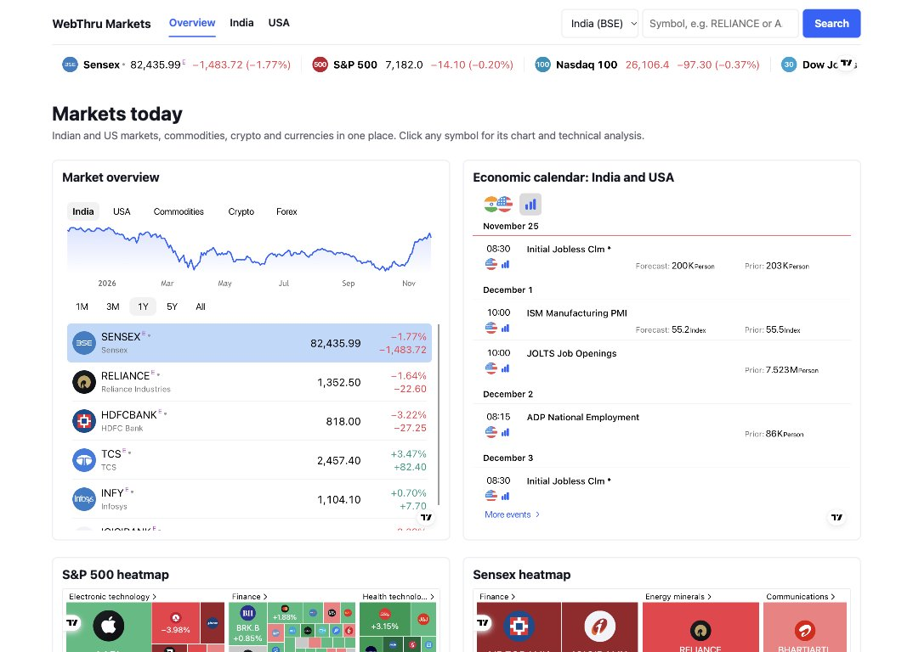
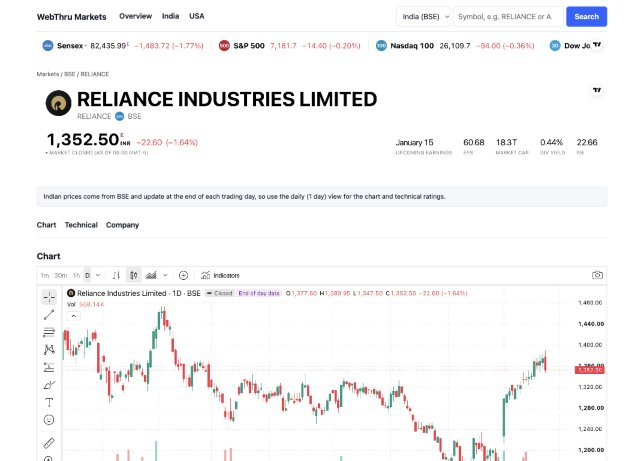
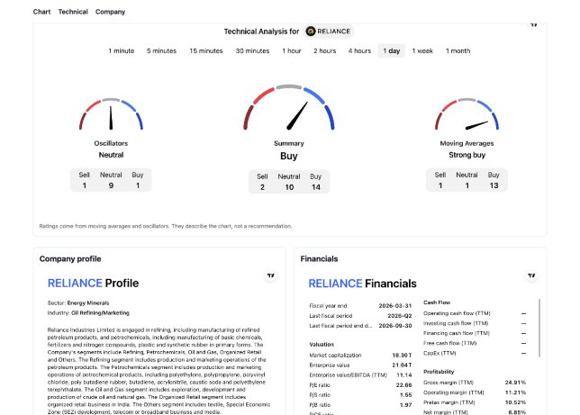
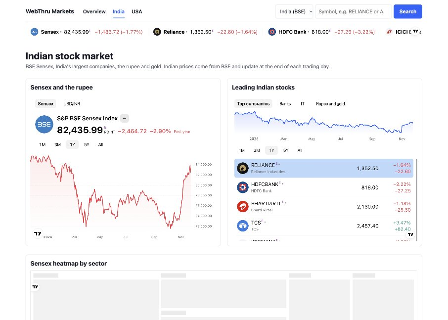
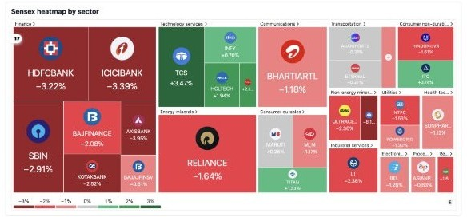
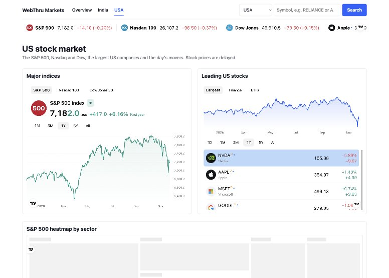
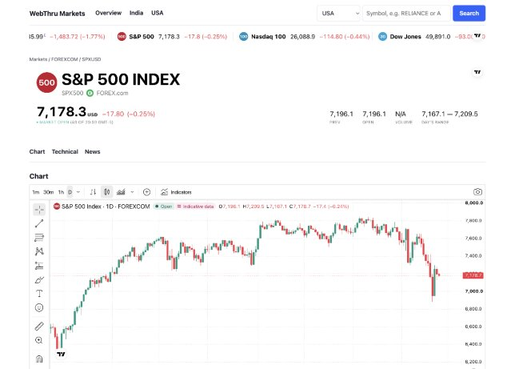

# WebThru Markets

Market data, charts and technical analysis for Indian and US markets, built into the [WebThru Services](https://webthruservices.com) website.



WebThru Markets brings a full markets experience to webthruservices.com: live tickers, sector heatmaps, stock screeners, economic calendars and a detail page for every stock with multi-timeframe technical ratings. It runs inside the existing WordPress site, with no servers to run and no data subscriptions to pay for.

## Features

- **Markets overview**: Indian and US indices, commodities, crypto and forex on one screen, with an India and US economic calendar and S&P 500 and Sensex heatmaps.
- **India and USA dashboards**: index charts, leading stocks by sector, market movers, stock screeners and a country economic calendar.
- **Symbol pages**: price header with key statistics, a full candlestick chart with drawing tools and indicators, company profile, financials and news.
- **Technical ratings**: oscillator, moving-average and summary gauges with Buy, Neutral and Sell signal counts, from 1-minute to monthly timeframes.
- **Symbol search**: search by ticker with an India or USA market switch. NSE symbols are routed to their BSE listing automatically.
- **Linked navigation**: click a stock in any market list to open its symbol page.
- **Responsive layout**: wide desktop grids reflow to a single column on phones.
- **Zero running cost**: no backend, no API keys, no data fees.

## Screenshots

| Symbol page | Technical ratings |
|---|---|
|  |  |
| **India dashboard** | **Sensex heatmap by sector** |
|  |  |
| **USA dashboard** | **S&P 500 symbol page** |
|  |  |

## Pages

| Page | Address | What it shows |
|---|---|---|
| Overview | `/markets/` | Ticker tape, multi-market overview, economic calendar, S&P 500 and Sensex heatmaps, top stories, US movers |
| India | `/markets/india/` | Sensex and rupee charts, leading stocks by sector, Sensex heatmap, BSE movers, India screener, Indian companies listed in the US, India calendar |
| USA | `/markets/usa/` | Index charts, largest stocks and ETFs, S&P 500 heatmap, movers, US screener, market news, US calendar |
| Symbol | `/markets/symbol/?tvwidgetsymbol=EXCHANGE:TICKER` | Price header, candlestick chart, technical ratings, company profile, financials, news |

## How it works

```
src/                      shared styles, navigation, widget layer, page layouts
  └── build.py  ──────►   dist/   one self-contained embed per page
                            └──►  WordPress pages under /markets/
```

- **Widget layer.** A small rendering layer (`mount()` in `src/shared.js`) builds every chart, list, gauge and heatmap from a config object, so each page is a short description of what to show.
- **Build step.** `build.py` combines the shared styles, navigation, footer and scripts with each page's layout into one self-contained embed per page. Each embed drops into a WordPress page with no plugins or theme changes.
- **Symbol routing.** The symbol page reads the symbol from its URL, validates it, maps NSE symbols to BSE, and shows only the sections that apply: company data for stocks, news where coverage exists.
- **Market data and charting** are provided by TradingView.

## Data coverage

| Market | Source | Updates |
|---|---|---|
| India: Sensex and BSE stocks | BSE | End of day |
| USA: stocks and ETFs | NASDAQ, NYSE | Delayed |
| USA: S&P 500, Nasdaq 100, Dow | FOREX.com index CFDs | Real time |
| Forex, including USD/INR | ICE Data Services, FXCM | Real time |
| Commodities: gold, silver, oil | OANDA | Real time |
| Crypto | Binance | Real time |

## Tech stack

Vanilla JavaScript, CSS, Python (build), TradingView widgets, WordPress with Elementor.

## Project structure

```
.
├── build.py              builds dist/ from src/
├── dist/                 deployable page embeds
│   ├── 1-markets-overview.html
│   ├── 2-markets-india.html
│   ├── 3-markets-usa.html
│   └── 4-markets-symbol.html
├── docs/
│   ├── DEPLOYMENT.md     deployment and configuration
│   └── screenshots/
└── src/
    ├── shared.css        design tokens and layout
    ├── shared.js         widget layer, search, routing
    ├── nav.html          markets navigation and search bar
    ├── footer.html       data notes and disclaimer
    └── pages/            layout (.html) and content (.js) for each page
```

## Development

```bash
python3 build.py
```

Edit files in `src/`, rebuild, then deploy the updated files from `dist/`. See [docs/DEPLOYMENT.md](docs/DEPLOYMENT.md) for deployment and configuration.

## Roadmap

- [x] Markets section on webthruservices.com for India and USA
- [ ] Own market data pipeline and API for live prices and candles
- [ ] In-house technical analysis engine and candlestick pattern scanner
- [ ] Market news and analysis from the WebThru team
- [ ] AI market assistant
- [ ] User accounts, watchlists and price alerts

## Disclaimer

WebThru Markets is for information only and is not investment advice. Market data and charts are provided by TradingView and its data providers.

---

© 2026 [WebThru Services](https://webthruservices.com)
